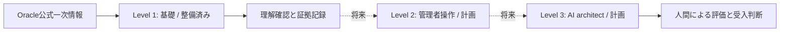

# OCI Validation Lab

[English](README.md) | [日本語](README.ja.md)

AWS・Azure・Google Cloudの経験があり、Oracle Cloud Infrastructure（OCI）は初めてのエンジニア向け学習・検証リポジトリです。Level 1の基礎から始め、同じリポジトリで将来の管理者操作とAI architect実験へ進みます。

**状態（2026-10-13）：初期文書を整備。OCIアカウントへのアクセス、リソース構築、試験受験は未実施。** Level 1/2/3は本リポジトリ独自の学習段階であり、Oracleの資格レベルではありません。Oracleとは独立した非公式学習資料で、試験合格を保証しません。

**更新（2026-10-18）：** [Level 1のオフラインTerraformモデル](terraform/level1-network/README.md)と[Level 2検証計画](docs/level2-validation-plan.md)を追加しました。OCIリソースは構築していません。[検証記録](docs/task-118-validation.md)を参照してください。

**更新（2026-10-23の実機演習）：** 東京リージョンで限定したVCNとprivate subnetをOCI Consoleから作成・削除しました。[公開用の実施記録](evidence/2026-10-23-level1-network.md)には観測結果と未確認事項を分けています。VM・IAM・Terraformの実機操作とLevel 1全体の完了は未実施です。請求確定額と匿名化済みスクリーンショットはありません。\n\n## 5分で始める

1. [範囲とロードマップ](docs/roadmap.md)を読む。
2. [最初のオフライン演習](labs/01-offline-foundations.md)でtenancy・compartment・region・VCNを描く。
3. [基礎ガイド](docs/foundations.md)の第1・2章の理解確認に答える。
4. [証拠テンプレート](templates/evidence.md)をローカルにコピーし、結果を `OFFLINE-ONLY` と記す。

最初の演習にOCIアカウント・キー・契約・クラウドコマンドは不要です。将来のクラウド演習は、対象範囲と予算を別途合意してから実施する計画です。

## 全体構成

## 読む資料

| 資料 | 目的 |
|---|---|
| [ロードマップ](docs/roadmap.md) | 順序、目安時間、修了基準、将来のLevel 2/3 |
| [資格目標対応表](docs/certification-map.md) | 現行Foundationsの目標と学習範囲 |
| [基礎ガイド](docs/foundations.md) | 7章の解説・シナリオ・理解確認・解答の要点 |
| [他クラウド比較](docs/cloud-comparison.md) | AWS/Azure/GCPの知識を、同一仕様と誤認せず応用 |
| [最初の演習](labs/01-offline-foundations.md) | オフラインで構成・権限・費用を検討。構築しない |
| [Level 1 Terraformモデル](terraform/level1-network/README.md) | 隔離したprivate networkの例とオフライン検証。構築しない |
| [Level 2検証計画](docs/level2-validation-plan.md) | 管理者操作の検証項目と証拠基準。実環境で未実施 |
| [検証記録](docs/task-118-validation.md) | ツールの版、実施結果、未検証項目 |
| [将来のハンズオン](labs/02-future-object-storage.md) | Object Storageの小規模演習計画。未実施 |
| [費用と削除確認](docs/cost-and-cleanup.md) | 見積り、停止条件、残存資源、請求確認 |
| [証拠テンプレート](templates/evidence.md) | 期待値と観測値、秘匿、費用・削除の証拠 |
| [章別記録](templates/chapter-check.md) | 解答、不確実性、再確認結果 |
| [公式資料一覧](docs/sources.md) | Oracle URLと確認日2026-10-13 |

## 資格目標

対象試験は **Oracle Cloud Infrastructure Foundations Associate**、試験 **1Z0-1085-26**、日本語試験 **1Z0-1085-26-JPN** です。認定資格名は **Oracle Cloud Infrastructure Certified Foundations Associate** で、2026年から資格名称の年度表記はありません。[日本語公式試験一覧](https://www.oracle.com/jp/education/certification/certification-exam-list/)では2026-10-13時点で60分・40問・合格ライン65%・受験料無償です。クラウド利用の無課金を意味しません。申込前に[公式学習path](https://learn.oracle.com/ols/learning-path/become-an-oci-foundations-associate/163512/163541)と[資格目標対応表](docs/certification-map.md)で再確認してください。分野配点は未確認です。

## 作業ルール

実行証拠と仮説を分けます。`PLANNED`・`OFFLINE-ONLY`・`EXECUTED`・`FAILED`・`BLOCKED` は作業状態です。理解確認の合格だけで本番適合性は証明できません。認証情報、実アカウントの識別子、請求書、未加工の画面、Terraform stateをコミットしません。privateリポジトリでも秘密情報は保管しません。

Level 1のTerraformモデルはオフライン検証用に追加しましたが、applyは未実施です。OCI認証情報、クラウドworkflow、自動クラウド操作はありません。資料と証拠の更新方法は[貢献ガイド](CONTRIBUTING.md)を参照してください。
