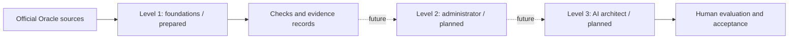

# OCI Validation Lab

[English](README.md) | [日本語](README.ja.md)

A learning and validation repository for engineers experienced with AWS, Azure, and Google Cloud who are new to Oracle Cloud Infrastructure (OCI). Start with Level 1 foundations; later use the same repository for administrator operations and AI architect experiments.

**Status (2026-10-13): documentation prepared; no OCI account access, resource deployment, or exam attempt performed.** Level 1/2/3 are this repository's learning stages, not Oracle certification levels. This is independent, unofficial study material with no guarantee of passing an exam.

## Five-minute start

1. Read [scope and roadmap](docs/roadmap.md).
2. Draw a tenancy, compartment, region, and VCN using [the first offline lab](labs/01-offline-foundations.md).
3. Answer chapter 1 and 2 checks in [the foundations guide](docs/foundations.md).
4. Copy [the evidence template](templates/evidence.md) locally and label the result `OFFLINE-ONLY`.

Reading and completing this first exercise require no OCI account, keys, subscription, or cloud commands. Future cloud exercises are plans requiring a separately agreed scope and budget.

## Learning structure

## Contents

| Guide | Use |
|---|---|
| [Roadmap](docs/roadmap.md) | Sequence, time estimates, completion gates, future Level 2/3 |
| [Certification map](docs/certification-map.md) | Current Foundations target and study coverage |
| [Foundations](docs/foundations.md) | Seven chapters with explanation, scenarios, checks and answer hints |
| [Cloud comparison](docs/cloud-comparison.md) | Transfer AWS/Azure/GCP knowledge without assuming equivalence |
| [First lab](labs/01-offline-foundations.md) | Offline topology, access and cost review; no deployment |
| [Future hands-on](labs/02-future-object-storage.md) | A bounded object-storage exercise, not executed |
| [Costs and cleanup](docs/cost-and-cleanup.md) | Estimate, stop conditions, residual resources and billing checks |
| [Evidence template](templates/evidence.md) | Expected vs observed results, redaction, cost and deletion evidence |
| [Chapter record](templates/chapter-check.md) | Record answers, uncertainty and retry results |
| [Official sources](docs/sources.md) | Oracle URLs and verification date 2026-10-13 |

## Certification target

The exam target is **Oracle Cloud Infrastructure Foundations Associate**, exam **1Z0-1085-26**, with Japanese exam **1Z0-1085-26-JPN**. The credential is **Oracle Cloud Infrastructure Certified Foundations Associate**; its name does not include an annual suffix in the 2026 naming. The [Japanese official exam list](https://www.oracle.com/jp/education/certification/certification-exam-list/) shows 60 minutes, 40 questions, a 65% pass threshold and no exam fee as of 2026-10-13. This does not make cloud usage free. Use the [official learning path](https://learn.oracle.com/ols/learning-path/become-an-oci-foundations-associate/163512/163541) and [certification map](docs/certification-map.md) to recheck details before booking. Domain weights remain unverified.

## Working rules

Keep evidence of real runs separate from hypotheses. `PLANNED`, `OFFLINE-ONLY`, `EXECUTED`, `FAILED`, and `BLOCKED` describe activity; passing a chapter check does not prove production readiness. Do not commit credentials, raw account identifiers, invoices, unredacted console captures, or Terraform state. GitHub repository privacy does not replace secret hygiene.

There are no deployable Terraform files, OCI credentials, cloud workflows, or automatic cloud actions in this initial version. See [contributing](CONTRIBUTING.md) for updating sources and records.
