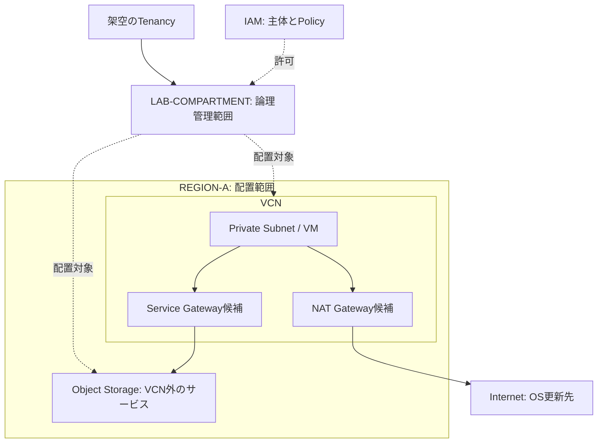

# Lab 01 — OCIを操作せず構成を説明する

状態：`PLANNED`（学習者は未実施）。確認日：2026-10-13。目安45–60分。OCIログイン・キー・CLI・Terraformは不要です。手順を終えてもライブ検証にはなりません。

## 目的と架空の要件

小さな画像管理アプリを考えます。画像は非公開、アプリVMはinternetから直接SSHさせない、配置は単一region、初回は机上設計だけです。実region/tenancy/OCIDを使いません。選択するサービスは候補であり、構築する指示ではありません。

## 手順

1. [基礎1–4章](../docs/foundations.md)と[比較表](../docs/cloud-comparison.md)を読む。
2. 下図を紙またはローカル文書へ写す。`LAB-COMPARTMENT`は論理範囲、`REGION-A`は配置であることを注記する。IAMとObject StorageはVCN内のVMとして描かない。
3. 架空のVCNを `10.20.0.0/16`、private subnetを `10.20.1.0/24` として書き、CIDRの包含を確認する。実ネットワークとの重複確認はしていない。VMの外向きOS更新とObject Storageアクセスの2経路を描く。NAT GatewayとService Gatewayがそれぞれ何のために必要か、公式資料を使って説明する。gatewayの実価格と対応条件は未確認として残す。
4. 「運用者は資源一覧のみ」「アプリは必要な画像のみ」を、主体・動作・資源・範囲に分解する。policy文を実際に適用しない。最小権限と、出来てはいけない操作を記す。架空の文 `Allow group LabReaders to inspect buckets in compartment LAB-COMPARTMENT` を注釈する：LabReaders=主体、inspect=動作、buckets=資源、LAB-COMPARTMENT=範囲。この文はobject本文を読む許可ではなく、identity domainを含む実環境への適用構文は未検証。
5. [費用/削除ガイド](../docs/cost-and-cleanup.md)からVM、volume、bucket、gateway、ログの5項目を見積り候補として列挙する。価格未確認の項目は `UNKNOWN` にする。
6. VMを終了しても残り得る資源と削除順序を説明する。既存資源は削除対象外と記す。
7. 理解確認を解き、[証拠テンプレート](../templates/evidence.md)を埋める。観測結果には「図を作成した」等の実際のローカル作業だけを記す。

## 通信レビューの記入例（架空・未検証）

| 始点 | 終点 | 用途 | 経路案 | 許可案 | 状態 |
|---|---|---|---|---|---|
| Private VM | OS更新先 | HTTPS 443 | NAT Gateway | 必要なegressのみ | PLANNED |
| Private VM | Object Storage | HTTPS 443 | Service Gateway | 対応service CIDRへのegress、IAM別確認 | PLANNED |
| Internet | VM | SSH 22 | 到達経路を設けない | ingressを許可しない | PLANNED |

Private VMへの管理アクセス方法は初回の対象外で、Level 2計画で設計します。

## 完了判定

図、権限要件の4要素、通信表、費用UNKNOWN一覧、削除候補、不明点が揃えば `OFFLINE-ONLY` と記録できます。実疎通・最小権限・請求・cleanupに `PASS` を付けません。

理解確認：①compartmentとregionの違いを説明する。②routeだけでObject Storageにアクセスできるか。③この演習で費用ゼロ/削除成功/可用性が実証されたか。

解答の要点：①論理管理と配置。②IAMと通信許可等も必要。③クラウド操作をしていないため実証されていない。この演習のためのOCI資源作成・削除はない。

English summary: Draw a fictional private-VM/object-storage topology and review access, routes, unknown costs and cleanup dependencies. Record only local artifacts as observed evidence; no cloud outcome is demonstrated.
