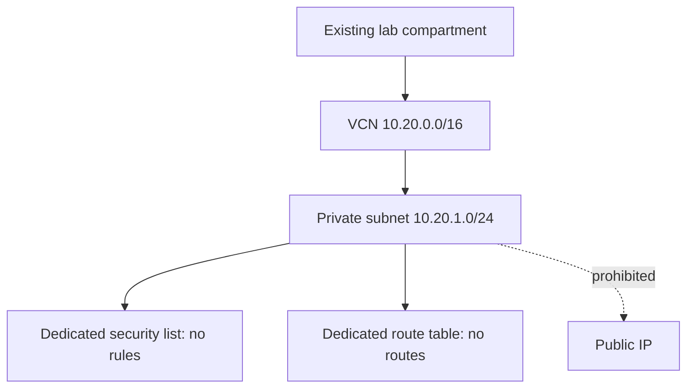

# Level 1 network model (not deployed)

Status: `OFFLINE-ONLY` for source and mock checks; `PLANNED` for OCI execution. This model turns the CIDRs from [Lab 01](../../labs/01-offline-foundations.md) into reviewable Terraform. It does not model the hypothetical VM, gateways, IAM, or Object Storage shown in that drawing.



## Offline checks

Prerequisites: Terraform 1.7+ and provider installation from the Terraform Registry. Installing the provider requires network access; the checks do not need OCI credentials or make OCI API calls. Run from this directory:

```sh
terraform init -backend=false
terraform fmt -check -recursive
terraform validate
terraform test
tflint --no-color
python ../../scripts/check_iac_scope.py
```

`terraform test` uses a mock OCI provider and a fake compartment string. Do not use this string in a real plan. `validate` proves configuration shape against the installed provider schema, not authorization, price, quotas, behavior, or successful deployment. `terraform plan` without the test mock would contact OCI and is outside this offline check.

TFLint's bundled Terraform rules check general HCL patterns. No OCI-specific TFLint rules are configured. The Python scope guard limits this example to four resource declarations and known private-network settings; it is not a full Terraform parser.

## Future deployment and cleanup procedure

No execution is authorized by this repository. Before any real run, obtain a separate scope and budget approval, verify the dedicated compartment and region, account-specific prices and limits, IAM least privilege, state storage and encryption, and a cleanup owner. Record the pre-run VCN/subnet inventory outside Git. Supply real variables through a secure local mechanism; never commit `tfvars`, state, plans, OCIDs, or credentials. Review the proposed plan and its resource count (exactly one VCN, security list, route table, and subnet) before applying. Stop if the plan contains replacements, gateways, public IPs, IAM changes, or any unrelated resource.

For a separately approved run, the operator would initialize Terraform, produce and review a saved plan, then apply that exact plan. After verification, the operator would review a destroy plan, destroy only resources owned by this state, and independently check the same region and compartment for remaining lab resources and delayed charges. Terraform state deletion alone is not cleanup evidence. If a resource is shared, pre-existing, or uncertain, stop and resolve ownership before destroy. See [cost and cleanup](../../docs/cost-and-cleanup.md) and [evidence template](../../templates/evidence.md).

No OCI resource has been created or destroyed in this task. `RESOURCE-CLEANUP: NOT-APPLICABLE`; `BILLING: NOT-MEASURED`.
